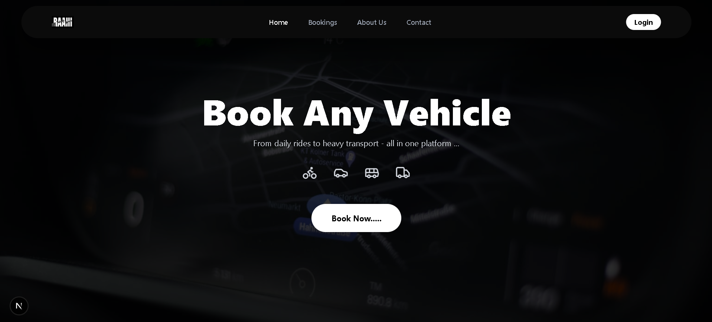
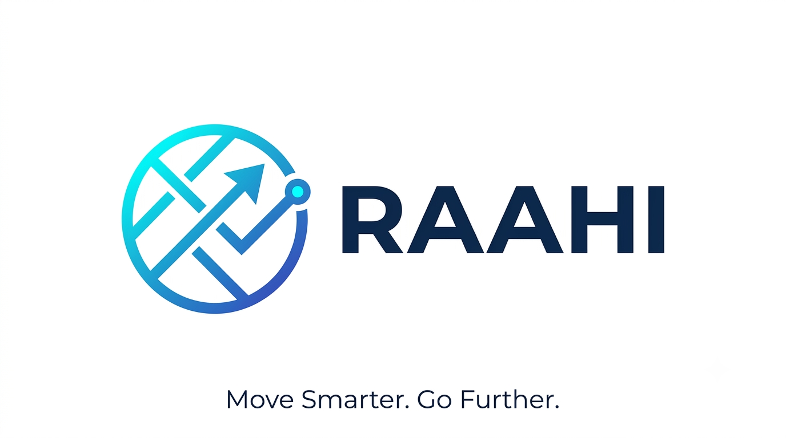
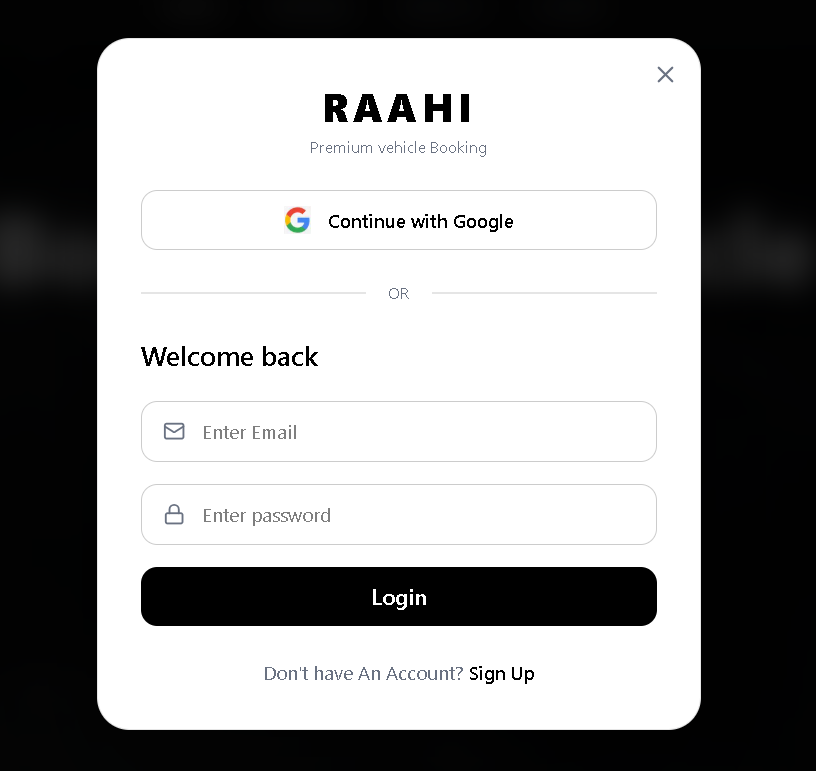
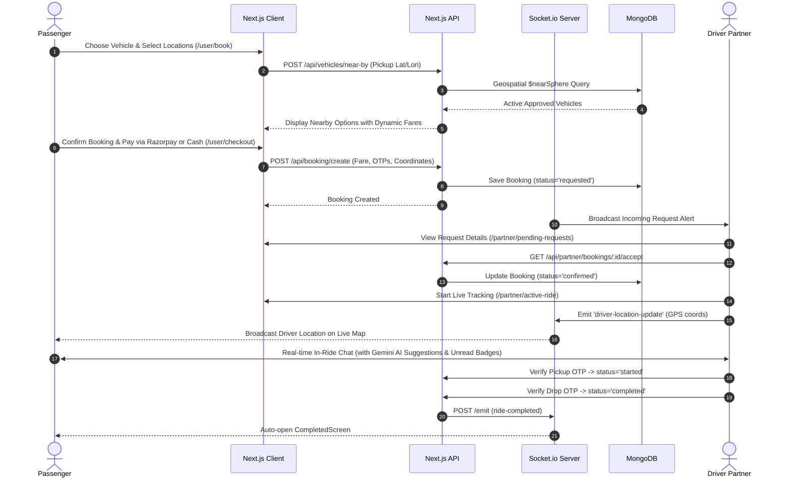
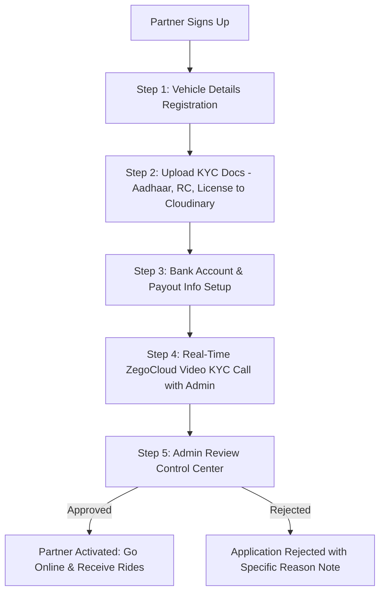

# 🚗 RAAHI - Smart Mobility & On-Demand Vehicle Booking Platform

<div align="center">
  
  
  <br />
  <br />

  [](https://nextjs.org/)
  [](https://react.dev/)
  [](https://www.typescriptlang.org/)
  [](https://tailwindcss.com/)
  [](https://www.mongodb.com/)
  [](https://socket.io/)
  [](https://leafletjs.com/)
  [](https://razorpay.com/)
  [](https://deepmind.google/technologies/gemini/)
  [](https://www.zegocloud.com/)
</div>

<br />

**RAAHI** is a full-stack, enterprise-grade on-demand vehicle booking and partner mobility ecosystem. Powered by **Next.js 16 (App Router)**, **React 19**, **Tailwind CSS v4**, and a dedicated **Socket.io** WebSocket microservice, RAAHI connects daily commuters, logistics clients, driver partners, and administrators in a single seamless interface.

From bikes and autos to personal cars and commercial logistics fleets (loading vehicles, heavy trucks), RAAHI provides real-time geospatial vehicle discovery, interactive Leaflet map pin pickers, OSRM routing, live GPS driver tracking, dual OTP verification (Pickup & Drop), in-ride real-time chat with Google Gemini AI suggestions and unread badges, automated Razorpay payment workflows, multi-step partner onboarding, and live ZegoCloud Video KYC verification.

---

## 🌟 Key Highlights & Core Features

### 👤 1. Passenger Ride Booking Experience
- **Interactive Vehicle Selection (`/user/book`):** Quick selection across bikes, autos, comfort cars, small cargo loaders, and heavy commercial trucks.
- **Interactive Map Location Picker Modal:** Choose pickup and drop destinations either via Geoapify autocomplete or by opening an interactive Leaflet map modal with draggable pins, search, and a one-tap GPS "Locate Me" button.
- **Real-Time Nearby Vehicle Matching (`/user/search`):** Geospatial MongoDB `$nearSphere` queries find active, approved drivers within proximity of the pickup location.
- **Dynamic Route & Distance Estimation:** Live route visualization on map using **OSRM (Open Source Routing Machine)** with turn geometry, road distance, ETA, and Haversine distance fallback.
- **Checkout & Fare Breakdown (`/user/checkout`):** Transparent pricing calculated using vehicle base fares, per-kilometer pricing, and distance with Cash and Razorpay Online payment options.
- **Live Active Ride Screen (`/user/ride/[id]`):**
  - Live Geoapify / Leaflet tracking displaying moving driver position, pickup marker, drop marker, dynamic route polylines, and real-time ETA updates.
  - Automatic transition to `CompletedScreen` upon trip completion.
- **Ride History & Status Tracking (`/user/bookings`):** Track all past and current rides with filterable statuses (`All`, `requested`, `confirmed`, `started`, `completed`, `cancelled`).

### 🤝 2. Driver Partner Platform & Live Active Ride
- **Automated Onboarding Pipeline (`/partner/onboarding`):**
  - **Step 1 — Vehicle Specs:** Vehicle category, registration number, model, base fare, and per-km pricing.
  - **Step 2 — KYC Documents:** Cloudinary document uploads for Driving License, Vehicle RC, and Aadhaar Card.
  - **Step 3 — Bank & Payouts:** Bank account, IFSC verification, and UPI ID for automated payouts.
  - **Step 4 — Video KYC:** Real-time 1-on-1 audio/video call with administrators powered by **ZegoCloud Web UIKit**.
- **Pending Booking Requests (`/partner/pending-requests`):** Incoming trip alerts with pickup/drop locations, passenger contact, and estimated earnings with live navbar notification badge and one-click Accept/Reject.
- **Live Active Ride Screen (`/partner/active-ride`):**
  - **Real-time GPS Streaming:** Broadcasts continuous driver coordinates via `navigator.geolocation.watchPosition` over WebSockets (`socketServer`).
  - **Interactive Geoapify Map:** Live map tracking driver location, pickup location, drop location, and dynamic route polylines.
  - **Secure OTP Verification:**
    - Pickup OTP verification (`/api/partner/bookings/otp/pickup/verify`) to transition ride to `started`.
    - Drop OTP verification (`/api/partner/bookings/otp/drop/verify`) to transition ride to `completed` and auto-notify user.
- **Partner Earnings Dashboard (`/partner/earning`):** Real-time analytics, total earnings, commission deductions, completed trip history, and visual earnings charts with **Recharts**.

### 💬 3. In-Ride Real-Time Chat & AI Reply Assistant (`RideChat.tsx`)
- **Real-Time WebSocket Communication:** Dedicated socket room per ride (`join-ride`) with instant message delivery without page reloads.
- **Strict Chronological Ordering:** Oldest messages at top and newest at bottom with smooth auto-scroll to latest messages.
- **Unread Message Notification Badges:** Real-time pulse notification badge with message count on the "Message" button for both User and Partner whenever an unread message arrives while chat is closed.
- **Google Gemini AI Quick Replies (`/api/chat/ai-suggestions`):** Smart context-aware reply generation tailored to the user's role (`user` or `driver`) based on recent chat messages.

### 🛡️ 4. Administrative Control Center
- **Executive Analytics KPIs & Earnings:** Live platform metrics, total partner counts, commission breakdown, platform gross volume, and visual revenue trends.
- **Interactive Review Queues (`/admin/reviews`):**
  - **Partner Reviews Queue:** High-resolution document previews (Aadhaar, License, RC), bank payout details verification, and one-click **Approve** or **Reject with Reason**.
  - **Vehicle Reviews Queue:** Fleet inspection and vehicle specifications validation.
  - **Video KYC Queue:** Initiate or join active video KYC sessions directly from the queue.
- **Strict Role Protection:** Middleware route guards and API authentication ensuring unauthorized users cannot access partner or admin interfaces.

### ⚡ 5. Real-Time WebSocket Microservice (`socketServer`)
- Independent Express + Socket.io server (`socketServer/index.js`) on port `8000`.
- Socket identity mapping with MongoDB user sessions (`identity`, `isOnline`, `socketId`).
- Real-time GPS location streaming (`driver-location-update` ➔ `driver-location`).
- Real-time in-ride chat communication (`chat-message`).
- Backend-to-client event gateway endpoint (`POST /emit`) for transactional server-side triggers (e.g. `ride-completed`).

---

## 📸 Screenshots

| Public Landing Page | Partner Onboarding Dashboard |
| :---: | :---: |
|  |  |

| Authentication Modal | Verified Brand Identity |
| :---: | :---: |
|  |  |

---

## 🛠️ Technology Stack

| Layer | Technologies |
| :--- | :--- |
| **Frontend Framework** | [Next.js 16](https://nextjs.org/) (App Router), [React 19](https://react.dev/), [TypeScript 5](https://www.typescriptlang.org/) |
| **Styling & UI** | [Tailwind CSS v4](https://tailwindcss.com/), [Motion](https://motion.dev/) (`motion/react`), [Lucide React](https://lucide.dev/) |
| **State Management** | [Redux Toolkit](https://redux-toolkit.js.org/) (`@reduxjs/toolkit`, `react-redux`) |
| **Maps & Routing** | [Leaflet](https://leafletjs.com/), [React-Leaflet 5](https://react-leaflet.js.org/), [Geoapify API](https://www.geoapify.com/) (Tiles, Geocoding, Reverse Geocoding), [OSRM](https://project-osrm.org/) |
| **Real-time WebSockets** | [Socket.io](https://socket.io/) & [Socket.io-Client 4](https://socket.io/docs/v4/client-api/) |
| **AI Suggestions** | [Google Gemini API](https://deepmind.google/technologies/gemini/) (Context-aware smart chat replies) |
| **Payments** | [Razorpay](https://razorpay.com/) (Orders creation, checkout, signature verification) |
| **Authentication** | [Auth.js / NextAuth v5 Beta](https://authjs.dev/), Google OAuth, Email Credentials, [bcryptjs](https://github.com/dcodeIO/bcrypt.js) |
| **Database & ODM** | [MongoDB Atlas](https://www.mongodb.com/) (Geospatial 2dsphere indexes), [Mongoose 9](https://mongoosejs.com/) |
| **Data Visualization** | [Recharts 3](https://recharts.org/) (Earnings charts & admin dashboard analytics) |
| **Video KYC** | [ZegoCloud Web UIKit](https://www.zegocloud.com/) (`@zegocloud/zego-uikit-prebuilt`) |
| **Document Storage** | [Cloudinary SDK](https://cloudinary.com/) (Secure Document & Vehicle Image Uploads) |
| **Email Service** | [Nodemailer](https://nodemailer.com/) (OTP Verification & Transactional Alerts) |
| **HTTP Client** | [Axios](https://axios-http.com/) |

---

## 📂 Project Architecture

```
Raahi/
├── README.md
├── socketServer/                       # WebSocket Microservice for Real-Time Location & Chat
│   ├── index.js                        # Socket.io server, location broadcast & user mapping
│   ├── models/
│   │   └── user.model.js               # User socket state schema
│   ├── package.json
│   └── .env                            # Socket server port & MongoDB configuration
└── client/                             # Next.js 16 Full-Stack Application
    ├── public/                         # Static assets (logos, screenshots, banners)
    ├── src/
    │   ├── auth.ts                     # NextAuth v5 configuration & JWT providers
    │   ├── InitUser.ts                 # Redux client-side user synchronization
    │   ├── app/
    │   │   ├── layout.tsx              # Root HTML layout with Leaflet CSS & Global Providers
    │   │   ├── page.tsx                # Role-aware landing entry point (User / Partner / Admin)
    │   │   ├── globals.css             # Tailwind CSS v4 design tokens
    │   │   ├── user/
    │   │   │   ├── book/               # Booking form with vehicle selection & map pin picker
    │   │   │   ├── search/             # Live nearby vehicle matching & route preview map
    │   │   │   ├── checkout/           # Ride checkout, OTP summary, Razorpay / Cash payment
    │   │   │   ├── bookings/           # Passenger ride history & active ride status
    │   │   │   └── ride/[id]/          # User live active ride screen with real-time map & chat
    │   │   ├── partner/
    │   │   │   ├── onboarding/         # Multi-step onboarding (vehicle, documents, bank)
    │   │   │   ├── pending-requests/   # Incoming booking requests queue
    │   │   │   ├── bookings/           # Partner ride history
    │   │   │   ├── active-ride/        # Live ride tracking with GPS broadcast, OTP & chat
    │   │   │   └── earning/            # Partner revenue analytics, payouts & history charts
    │   │   ├── admin/
    │   │   │   ├── dashboard/          # Admin analytics & KPI metrics
    │   │   │   ├── earning/            # Platform revenue & commission analytics
    │   │   │   └── reviews/            # Partner and vehicle verification screens
    │   │   ├── video-kyc/[roomId]/     # 1-on-1 ZegoCloud Video KYC call room
    │   │   └── api/
    │   │       ├── auth/               # User registration, email verification, NextAuth handler
    │   │       ├── booking/            # Booking creation, active ride, cancel, confirm
    │   │       ├── chat/               # Send, get-all, and Gemini AI smart suggestions
    │   │       ├── partner/            # Pending requests, accept/reject, active ride, OTPs, onboarding
    │   │       ├── admin/              # Review queue, approve, reject, video-kyc, earnings
    │   │       ├── payment/            # Razorpay order creation & signature verification
    │   │       ├── vehicles/near-by/   # Geospatial 2dsphere proximity search
    │   │       └── user/               # Profile & user bookings history
    │   ├── components/
    │   │   ├── LocationPickerModal.tsx # Interactive Leaflet map picker for pickup/drop
    │   │   ├── SearchMap.tsx           # Route polyline & interactive route preview map
    │   │   ├── LiveRideMap.tsx         # Live driver tracking map with Geoapify tiles
    │   │   ├── RideChat.tsx            # Real-time WebSocket chat modal with AI replies
    │   │   ├── PanelContent.tsx        # Active ride details, unread badge, OTP actions, status
    │   │   ├── CompletedScreen.tsx     # Trip completion screen with receipt summary
    │   │   ├── GeoUpdater.tsx          # Real-time background geolocation synchronizer
    │   │   ├── VehicleSlider.tsx       # Landing page interactive fleet showcase
    │   │   ├── VehicleCard.tsx         # Search result vehicle card with dynamic fares
    │   │   ├── AdminDashboard.tsx      # Admin queue management & metrics
    │   │   ├── PartnerEarning.tsx      # Partner earnings graphs & summaries
    │   │   ├── AdminEarning.tsx        # Platform commission & revenue graphs
    │   │   ├── DocPreview.tsx          # High-resolution KYC document preview modal
    │   │   ├── AuthModel.tsx           # Authentication modal (Google, Email, Password, OTP)
    │   │   └── Nav.tsx & Footer.tsx    # Responsive navigation & footer
    │   ├── models/
    │   │   ├── booking.model.ts        # Ride booking schema (GeoJSON Points, OTPs, Fares)
    │   │   ├── user.model.ts           # User & Partner account schema with roles
    │   │   ├── vehicle.model.ts        # Vehicle specifications & per-km pricing schema
    │   │   ├── partnerDocs.model.ts    # KYC documents (Aadhaar, License, RC) schema
    │   │   ├── partnerBank.model.ts    # Bank account & payout details schema
    │   │   └── chatMessage.model.ts    # In-ride persistent chat message schema
    │   ├── redux/                      # Redux store & userSlice
    │   └── lib/
    │       ├── db.ts                   # Cached MongoDB Mongoose connection
    │       ├── socket.ts               # Socket.io client singleton
    │       ├── cloudinary.ts           # Cloudinary buffer upload utility
    │       └── sendMail.ts             # Nodemailer OTP email dispatcher
    ├── package.json
    ├── tsconfig.json
    └── next.config.ts
```

---

## 🔄 Core System Workflows

### 1. Ride Booking & Dispatch Lifecycle


### 2. Partner Onboarding & Admin Verification


---

## 🗄️ Database Schemas Summary

| Model | Collection | Primary Attributes |
| :--- | :--- | :--- |
| **`User`** | `users` | `name`, `email`, `password`, `role` (`user`, `partner`, `admin`), `partnerStatus` (`pending`, `approved`, `rejected`), `partnerOnBoardingSteps` (0–8), `mobileNumber`, `otp`, `isEmailVerified`, `socketId`, `isOnline` |
| **`Vehicle`** | `vehicles` | `owner` (ref: `User`), `type` (`bike`, `car`, `truck`, `bus`, `loading`, `auto`), `vehicleNumber`, `vehicleModel`, `imageUrl`, `baseFare`, `pricePerKM`, `status` (`pending`, `approved`, `rejected`), `location` (`Point`, 2dsphere) |
| **`Booking`** | `bookings` | `user` (ref: `User`), `driver` (ref: `User`), `vehicle` (ref: `Vehicle`), `pickUpAddress`, `dropAddress`, `pickUpLocation` (`Point`), `dropLocation` (`Point`), `fare`, `userMobileNumber`, `driverMobileNumber`, `bookingStatus` (`requested`, `confirmed`, `started`, `completed`, `cancelled`, `rejected`), `paymentStatus`, `pickUpOtp`, `dropOtp` |
| **`ChatMessage`** | `chatmessages` | `bookingId` (ref: `Booking`), `sender` (`user`, `driver`), `text`, `createdAt` |
| **`PartnerDocs`**| `partnerdocs` | `owner` (ref: `User`), `aadharUrl`, `rcUrl`, `licenseUrl`, `status` (`pending`, `approved`, `rejected`), `rejectionReason` |
| **`PartnerBank`**| `partnerbanks` | `owner` (ref: `User`), `accountHolderName`, `accountNumber`, `ifscCode`, `upiId`, `status` (`not_added`, `added`, `verified`) |

---

## 📡 Key API Routes

### 🚗 Passenger & Booking Endpoints
| Method | Endpoint | Description | Access |
| :--- | :--- | :--- | :--- |
| `POST` | `/api/vehicles/near-by` | Geospatial search for nearby available vehicles | Authenticated |
| `POST` | `/api/booking/create` | Create a new ride request with pickup & drop OTPs | Passenger |
| `POST` | `/api/user/active-ride` | Retrieve active booking details for the passenger | Passenger |
| `GET`  | `/api/booking/active` | Get active booking for the current passenger | Passenger |
| `GET`  | `/api/user/bookings` | Fetch passenger ride history | Passenger |
| `POST` | `/api/booking/:id/cancel` | Cancel an active booking | Passenger |

### 💳 Payments (Razorpay) Endpoints
| Method | Endpoint | Description | Access |
| :--- | :--- | :--- | :--- |
| `POST` | `/api/payment/create` | Create a new Razorpay payment order | Passenger |
| `POST` | `/api/payment/verify` | Verify Razorpay payment signature & update booking | Passenger |

### 💬 Chat & AI Endpoints
| Method | Endpoint | Description | Access |
| :--- | :--- | :--- | :--- |
| `POST` | `/api/chat/send` | Persist an in-ride chat message | In-Ride Participants |
| `POST` | `/api/chat/get-all` | Fetch all chat messages for a ride (chronological order) | In-Ride Participants |
| `POST` | `/api/chat/ai-suggestions` | Generate contextual quick replies using Google Gemini API | In-Ride Participants |

### 🤝 Driver Partner Endpoints
| Method | Endpoint | Description | Access |
| :--- | :--- | :--- | :--- |
| `GET`  | `/api/partner/my-active` | Retrieve current confirmed or ongoing active ride | Partner |
| `GET`  | `/api/partner/bookings/pending` | Fetch pending incoming ride requests | Partner |
| `GET`  | `/api/partner/bookings/pending-requests-count` | Get count of active incoming ride requests | Partner |
| `GET`  | `/api/partner/bookings/:id/accept` | Accept an incoming ride request | Partner |
| `POST` | `/api/partner/bookings/:id/reject` | Reject an incoming ride request | Partner |
| `POST` | `/api/partner/bookings/otp/pickup/send` | Send / resend pickup OTP | Partner |
| `POST` | `/api/partner/bookings/otp/pickup/verify` | Verify pickup OTP to start ride | Partner |
| `POST` | `/api/partner/bookings/otp/drop/send` | Send / resend drop OTP | Partner |
| `POST` | `/api/partner/bookings/otp/drop/verify` | Verify drop OTP to complete ride | Partner |
| `GET`  | `/api/partner/earning` | Retrieve partner revenue summary & breakdown | Partner |
| `GET`  | `/api/partner/bookings` | Retrieve driver partner ride history | Partner |
| `POST` | `/api/partner/onboarding/vehicle` | Save or update partner vehicle specifications | Partner |
| `POST` | `/api/partner/onboarding/document` | Upload KYC documents to Cloudinary | Partner |
| `POST` | `/api/partner/onboarding/bank` | Save bank payout & UPI details | Partner |

### 🛡️ Administrative Endpoints
| Method | Endpoint | Description | Access |
| :--- | :--- | :--- | :--- |
| `GET`  | `/api/admin/dashboard` | Fetch KPI stats and pending review queues | Admin |
| `GET`  | `/api/admin/earning` | Fetch platform revenue, gross volume & commission | Admin |
| `GET`  | `/api/admin/reviews/partner/:id` | Fetch comprehensive review data for a partner | Admin |
| `GET`  | `/api/admin/reviews/partner/:id/approve` | Approve partner application & activate account | Admin |
| `POST` | `/api/admin/reviews/partner/:id/reject` | Reject application with specific reason note | Admin |
| `GET`  | `/api/admin/reviews/vehicles/:id/approve` | Approve vehicle registration | Admin |
| `POST` | `/api/admin/reviews/vehicles/:id/reject` | Reject vehicle registration | Admin |
| `POST` | `/api/admin/video-kyc/complete` | Mark partner video KYC as verified | Admin |

---

## 🔌 Socket.io Events Reference

| Event Name | Direction | Payload | Description |
| :--- | :--- | :--- | :--- |
| `identity` | Client ➔ Server | `{ userId }` | Registers user socket ID with MongoDB session |
| `update-location` | Client ➔ Server | `{ userId, latitude, longitude }` | Updates partner current location coordinates |
| `join-ride` | Client ➔ Server | `bookingId` | Joins the dedicated socket room for an active ride |
| `driver-location-update` | Client ➔ Server | `{ bookingId, latitude, longitude, status }` | Broadcasts real-time vehicle GPS to room participants |
| `driver-location` | Server ➔ Client | `{ latitude, longitude, status }` | Passenger receives real-time vehicle coordinates on map |
| `chat-message` | Bidirectional | `{ bookingId, sender, text, createdAt }` | In-ride messaging between passenger and driver |
| `ride-completed` | Server ➔ Client | `{ bookingId }` | Triggers automatic transition to `CompletedScreen` for user |

---

## ⚙️ Installation & Setup

### Prerequisites
- **Node.js** (v20.x or higher)
- **npm** (v10.x or higher)
- **MongoDB** instance (Local or [MongoDB Atlas](https://www.mongodb.com/cloud/atlas))
- Cloud accounts for **Cloudinary**, **Google Cloud Console**, **Geoapify**, **Razorpay**, **Google Gemini AI**, and **ZegoCloud**

### 1. Clone the Repository
```bash
git clone https://github.com/AkashGautam-27/Raahi.git
cd Raahi
```

### 2. Configure & Run the Socket Server
```bash
cd socketServer
npm install
```

Create a `.env` file in `socketServer/`:
```env
PORT=8000
MONGODB_URI=your_mongodb_connection_string
NEXT_BASE_URL=http://localhost:3000
```

Start the socket server:
```bash
npm run dev
```

### 3. Configure & Run the Next.js Client
Open a new terminal window:
```bash
cd client
npm install
```

Create a `.env.local` file in `client/`:
```env
# Database Connection
MONGO_URI=your_mongodb_atlas_connection_string

# Authentication Secrets
AUTH_SECRET=your_nextauth_jwt_secret_key
AUTH_GOOGLE_ID=your_google_oauth_client_id.apps.googleusercontent.com
AUTH_GOOGLE_SECRET=your_google_oauth_client_secret

# Email Service (Nodemailer SMTP)
EMAIL=your_email@gmail.com
PASS=your_gmail_app_password

# Cloudinary (KYC Documents & Vehicle Photos)
CLOUDINARY_CLOUD_NAME=your_cloudinary_cloud_name
CLOUDINARY_API_KEY=your_cloudinary_api_key
CLOUDINARY_API_SECRET=your_cloudinary_api_secret

# Razorpay Payment Gateway
RAZORPAY_KEY_ID=your_razorpay_key_id
RAZORPAY_KEY_SECRET=your_razorpay_key_secret

# Google Gemini AI (Smart Chat Reply Suggestions)
GEMINI_API_URL=https://generativelanguage.googleapis.com/v1beta/models/gemini-1.5-flash:generateContent
GEMINI_API_KEY=your_gemini_api_key

# ZegoCloud (Real-Time Video KYC)
NEXT_PUBLIC_ZEGO_APP_ID=your_zegocloud_app_id
NEXT_PUBLIC_ZEGO_SERVER_SECRET=your_zegocloud_server_secret

# Geoapify (Map Tiles, Geocoding & Address Autocomplete)
NEXT_PUBLIC_GEOAPIFY_API_KEY=your_geoapify_api_key

# Socket Server Connection URL
NEXT_PUBLIC_SOCKET_SERVER_URL=http://localhost:8000
```

Start the Next.js development server:
```bash
npm run dev
```

Open [http://localhost:3000](http://localhost:3000) in your browser.

---

## 🧑‍💻 Contributing

Contributions, bug reports, and feature proposals are welcome!
1. Fork the Project
2. Create your Feature Branch (`git checkout -b feature/AmazingFeature`)
3. Commit your Changes (`git commit -m 'feat: Add AmazingFeature'`)
4. Push to the Branch (`git push origin feature/AmazingFeature`)
5. Open a Pull Request

---

## 📄 License

This project is licensed under the **MIT License**.
