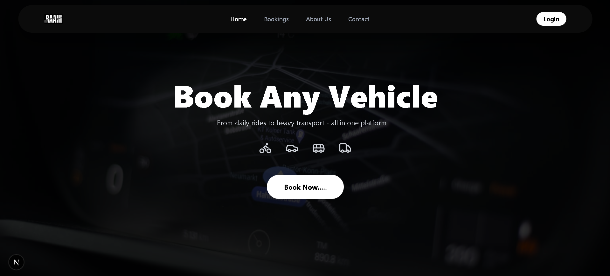
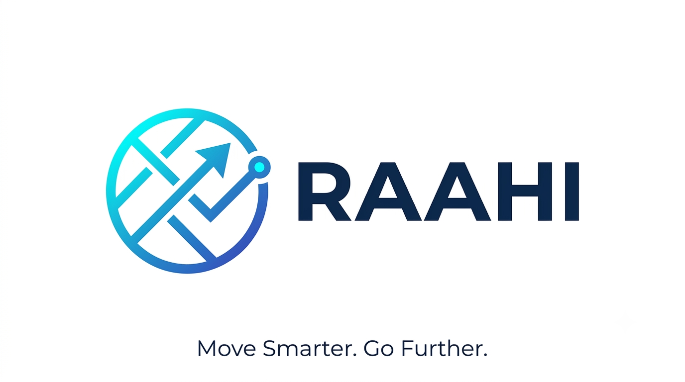
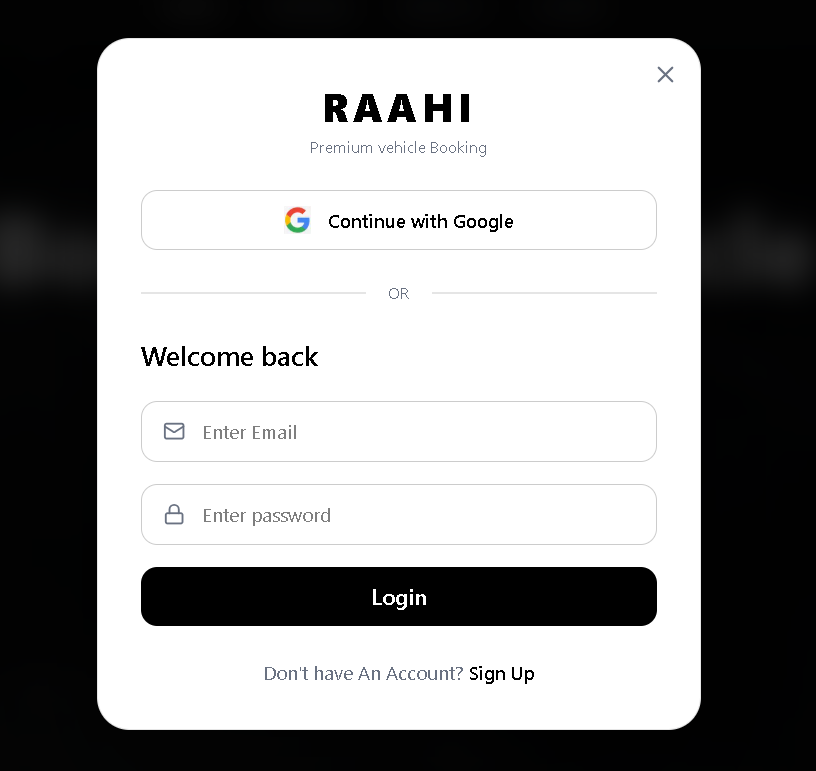
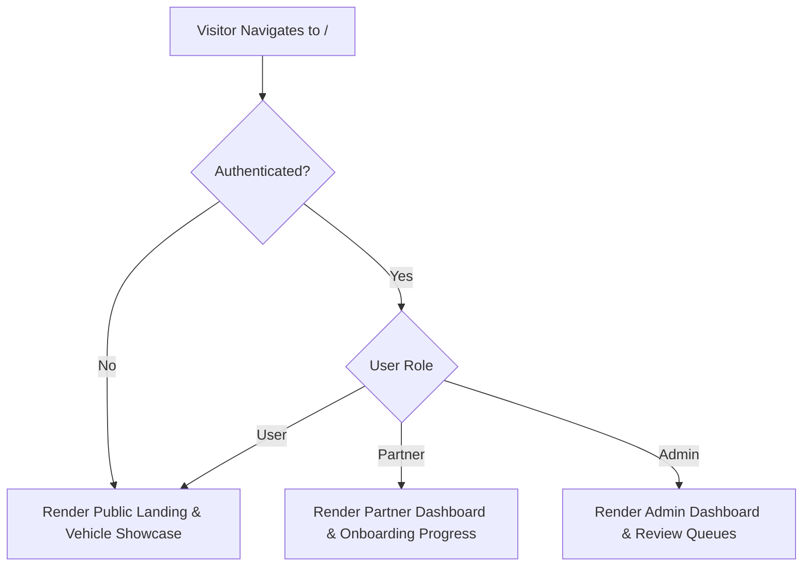
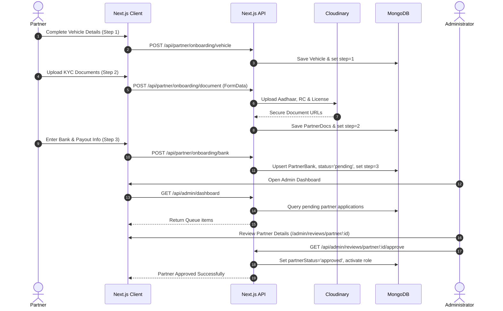

# 🚗 RAAHI - Next-Generation Vehicle Booking & Partner Mobility Platform

<div align="center">
  
  
  <br />
  <br />

  [](https://nextjs.org/)
  [](https://react.dev/)
  [](https://www.typescriptlang.org/)
  [](https://tailwindcss.com/)
  [](https://www.mongodb.com/)
  [](https://www.zegocloud.com/)
</div>

<br />

**RAAHI** is a full-stack, enterprise-grade vehicle booking and mobility partner onboarding platform. Built with **Next.js 16 (App Router)**, **React 19**, and **Tailwind CSS v4**, RAAHI delivers a unified experience connecting daily commuters, commercial fleet clients, driver partners, and administrators.

From daily cab and bike bookings to heavy commercial logistics (trucks, buses, loading vehicles), RAAHI features an **8-step automated partner onboarding pipeline**, **Cloudinary document uploads**, **ZegoCloud real-time Video KYC**, and a centralized **Admin Review Control Center**.

---

## 🌟 Key Highlights & Features

### 👤 1. Public & Customer Experience
- **Dynamic Vehicle Showcase:** Interactive vehicle fleet slider showcasing daily rides (Bikes, Cars, Autos) and commercial heavy transport (Trucks, Buses, Loaders).
- **Modern Auth Modal:** Smooth modal authentication supporting **Google OAuth** and **Email OTP / Password** credentials with JWT sessions.
- **Micro-Interactions:** Premium dark & light theme styling with fluid animations powered by Motion (`motion/react`).
- **Role-Based Home Navigation:** Automatic view rendering based on user role (`user`, `partner`, or `admin`).

### 🤝 2. Comprehensive Partner Onboarding (8-Step Pipeline)
- **Step 1 — Vehicle Registration:** Type selection, vehicle registration number validation, model details, and base fare configuration.
- **Step 2 — KYC Document Verification:** Secure multi-file upload for **Aadhaar Card**, **Driving License**, and **Vehicle RC** with server-side validation and Cloudinary cloud storage.
- **Step 3 — Bank & Payout Setup:** Bank account number, IFSC code validation, account holder name, and UPI ID setup for payout automation.
- **Step 4 — Review & Submission:** Document integrity check and status lock pending admin verification.
- **Step 5 — Video KYC Verification:** Real-time 1-on-1 audio/video call integration with administrators powered by **ZegoCloud UIKit**.
- **Step 6 — Pricing & Configuration:** Custom fare configurations, pricing per kilometer, and waiting charges.
- **Step 7 & 8 — Final Review & Live Go-To-Market:** Partner activation, route assignment, and live dispatch readiness.

### 🛡️ 3. Administrative Control Center
- **Executive Analytics KPIs:** Live metrics showing total partners, approved partners, pending queue counts, and rejected applications.
- **Interactive Review Queues:** Tabbed switching between:
  - **Partner Reviews Queue:** Inspect applicant vehicle specs, preview KYC documents in high-resolution modal viewers, examine bank payout details, and trigger one-click **Approve** or **Reject with Reason** actions.
  - **Video KYC Queue:** Initiate or join active video KYC sessions directly from the queue.
  - **Vehicle Reviews Queue:** Fleet inspection and registration approval.
- **Strict Role Protection:** Protected API routes and page proxy middleware (`src/proxy.ts`) ensuring unauthorized users cannot access admin or partner interfaces.

---

## 📸 Screenshots

| Landing Page | Partner Onboarding |
| :---: | :---: |
|  |  |

| Authentication Modal | Verified Brand Identity |
| :---: | :---: |
|  |  |

---

## 🛠️ Technology Stack

| Layer | Technologies |
| :--- | :--- |
| **Frontend Framework** | [Next.js 16](https://nextjs.org/) (App Router), [React 19](https://react.dev/), [TypeScript](https://www.typescriptlang.org/) |
| **Styling & Design** | [Tailwind CSS v4](https://tailwindcss.com/), [Motion](https://motion.dev/) (`motion/react`), [Lucide React](https://lucide.dev/) |
| **State Management** | [Redux Toolkit](https://redux-toolkit.js.org/) (`@reduxjs/toolkit`, `react-redux`) |
| **Authentication** | [Auth.js / NextAuth v5 Beta](https://authjs.dev/), Google OAuth, Credentials Provider, [bcryptjs](https://github.com/dcodeIO/bcrypt.js) |
| **Database & ODM** | [MongoDB Atlas](https://www.mongodb.com/), [Mongoose 9](https://mongoosejs.com/) |
| **Video Calling (KYC)** | [ZegoCloud Web UIKit](https://www.zegocloud.com/) (`@zegocloud/zego-uikit-prebuilt`) |
| **Media & File Storage** | [Cloudinary SDK](https://cloudinary.com/) (Secure Document Uploads) |
| **Email Services** | [Nodemailer](https://nodemailer.com/) (OTP Verification & Transactional Alerts) |
| **HTTP Client** | [Axios](https://axios-http.com/) |

---

## 📂 Project Architecture

```
Raahi/
├── README.md
└── client/
    ├── public/                         # Static assets (logos, screenshots, banners)
    ├── src/
    │   ├── proxy.ts                    # Next.js 16 proxy / route guard middleware
    │   ├── auth.ts                     # NextAuth v5 configuration & providers
    │   ├── InitUser.ts                 # Redux client-side user synchronization
    │   ├── app/
    │   │   ├── layout.tsx              # Root HTML layout with Redux & Session providers
    │   │   ├── page.tsx                # Role-aware entry point (User / Partner / Admin)
    │   │   ├── globals.css             # Tailwind CSS v4 directives & root design system
    │   │   ├── admin/
    │   │   │   └── reviews/
    │   │   │       └── partner/[id]/   # Detailed Partner Review inspection & action screen
    │   │   ├── partner/
    │   │   │   └── onboarding/
    │   │   │       ├── vehicle/        # Step 1: Vehicle registration form
    │   │   │       ├── documents/      # Step 2: KYC documents upload
    │   │   │       └── bank/           # Step 3: Bank payout setup
    │   │   ├── zego/                   # 1-on-1 ZegoCloud Video KYC call room
    │   │   └── api/
    │   │       ├── auth/               # [...nextauth], register, verify-email
    │   │       ├── user/me/            # Authenticated user profile retrieval
    │   │       ├── partner/onboarding/ # Vehicle, Document (Cloudinary), & Bank endpoints
    │   │       └── admin/
    │   │           ├── dashboard/      # Admin KPI stats & queue listings
    │   │           └── reviews/        # Partner review details, approval & rejection APIs
    │   ├── components/
    │   │   ├── AdminDashboard.tsx      # Admin metrics & queue navigation
    │   │   ├── ContentList.tsx         # Unified queue items (Review, KYC, Vehicles)
    │   │   ├── DocPreview.tsx          # High-resolution KYC document modal viewer
    │   │   ├── AnimatedCard.tsx        # Motion-animated container cards
    │   │   ├── PartnerDashboard.tsx    # 8-step onboarding visual tracker
    │   │   ├── VehicleSlider.tsx       # Interactive landing page fleet slider
    │   │   ├── AuthModel.tsx           # Authentication modal (Email, Password, OTP)
    │   │   ├── Nav.tsx & Footer.tsx    # Responsive header navigation & footer
    │   │   └── Kpi.tsx                 # Analytical KPI stat metric cards
    │   ├── models/
    │   │   ├── user.model.ts           # User & Partner account schema
    │   │   ├── vehicle.model.ts        # Vehicle specifications & fares schema
    │   │   ├── partnerDocs.model.ts    # KYC documents (Aadhaar, RC, License) schema
    │   │   └── partnerBank.model.ts    # Bank account & payout details schema
    │   ├── redux/                      # Redux store configuration & userSlice
    │   └── lib/
    │       ├── db.ts                   # Cached MongoDB Mongoose connection
    │       ├── cloudinary.ts           # Cloudinary buffer upload utility
    │       └── sendMail.ts             # Nodemailer OTP email dispatcher
    ├── package.json
    ├── tsconfig.json
    └── next.config.ts
```

---

## 🔄 Core Workflows

### 1. Role-Based Navigation & Access Flow


### 2. Partner Onboarding & Review Pipeline


---

## 🗄️ Database Schemas Summary

| Model | Collection | Primary Attributes |
| :--- | :--- | :--- |
| **`User`** | `users` | `name`, `email`, `password`, `role` (`user`, `partner`, `admin`), `partnerStatus` (`pending`, `approved`, `rejected`), `partnerOnBoardingSteps` (0–8), `mobileNumber`, `otp`, `isEmailVerified` |
| **`Vehicle`** | `vehicles` | `owner` (ref: `User`), `type` (`bike`, `car`, `truck`, `bus`, `loading`, `auto`), `vehicleNumber`, `vehicleModel`, `imageUrl`, `baseFare`, `pricePerKm`, `status` (`pending`, `approved`, `rejected`) |
| **`PartnerDocs`**| `partnerdocs` | `owner` (ref: `User`), `aadharUrl`, `rcUrl`, `licenseUrl`, `status` (`pending`, `approved`, `rejected`), `rejectionReason` |
| **`PartnerBank`**| `partnerbanks` | `owner` (ref: `User`), `accountHolderName`, `accountNumber`, `ifscCode`, `upiId`, `status` (`not_added`, `added`, `verified`) |

---

## 📡 Key API Routes

| Method | Endpoint | Description | Access |
| :--- | :--- | :--- | :--- |
| `POST` | `/api/auth/register` | Register new user account with hashed password | Public |
| `POST` | `/api/auth/verify-email` | Verify email OTP code | Public |
| `GET` | `/api/user/me` | Retrieve authenticated user profile | Authenticated |
| `POST` | `/api/partner/onboarding/vehicle` | Save or update partner vehicle specifications | Partner |
| `POST` | `/api/partner/onboarding/document` | Upload KYC documents to Cloudinary | Partner |
| `POST` | `/api/partner/onboarding/bank` | Save bank payout & UPI details | Partner |
| `GET` | `/api/admin/dashboard` | Fetch KPI stats and pending review queues | Admin |
| `GET` | `/api/admin/reviews/partner/:id` | Fetch comprehensive review data for a partner | Admin |
| `GET` | `/api/admin/reviews/partner/:id/approve` | Approve partner application & update status | Admin |
| `POST`| `/api/admin/reviews/partner/:id/reject` | Reject application with specific reason note | Admin |

---

## ⚙️ Installation & Setup

### Prerequisites
- **Node.js** (v20.x or higher)
- **npm** (v10.x or higher)
- **MongoDB** instance (Local or [MongoDB Atlas](https://www.mongodb.com/cloud/atlas))
- Cloud accounts for **Cloudinary**, **Google Cloud Console**, and **ZegoCloud**

### 1. Clone the Repository
```bash
git clone https://github.com/AkashGautam-27/Raahi.git
cd Raahi
```

### 2. Navigate to Client & Install Dependencies
```bash
cd client
npm install
```

### 3. Configure Environment Variables
Create a `.env` file inside the `client` directory:
```bash
# In client directory
touch .env
```

Populate the `.env` file with the following keys:
```env
# Database
MONGO_URI=mongodb+srv://<username>:<password>@cluster0.mongodb.net/Raahi

# NextAuth Configuration
AUTH_SECRET=your_nextauth_jwt_secret_key

# Google OAuth Credentials (for Social Sign-In)
AUTH_GOOGLE_ID=your_google_oauth_client_id.apps.googleusercontent.com
AUTH_GOOGLE_SECRET=your_google_oauth_client_secret

# Email Verification (Nodemailer SMTP)
EMAIL=your_email@gmail.com
PASS=your_gmail_app_password

# Cloudinary (KYC Documents & Vehicle Image Storage)
CLOUDINARY_CLOUD_NAME=your_cloudinary_cloud_name
CLOUDINARY_API_KEY=your_cloudinary_api_key
CLOUDINARY_API_SECRET=your_cloudinary_api_secret

# ZegoCloud (Real-time Video KYC Verification)
NEXT_PUBLIC_ZEGO_APP_ID=your_zegocloud_app_id
NEXT_PUBLIC_ZEGO_SERVER_SECRET=your_zegocloud_server_secret
```

### 4. Run the Development Server
```bash
npm run dev
```

Visit [http://localhost:3000](http://localhost:3000) in your browser.

### 5. Production Build
```bash
npm run build
npm run start
```

---

## 🧑‍💻 Contributing

Contributions, bug reports, and feature proposals are welcome!
1. Fork the Project
2. Create your Feature Branch (`git checkout -b feature/AmazingFeature`)
3. Commit your Changes (`git commit -m 'feat: Add AmazingFeature'`)
4. Push to the Branch (`git push origin feature/AmazingFeature`)
5. Open a Pull Request

---

## 📄 License

This project is licensed under the **MIT License**.
